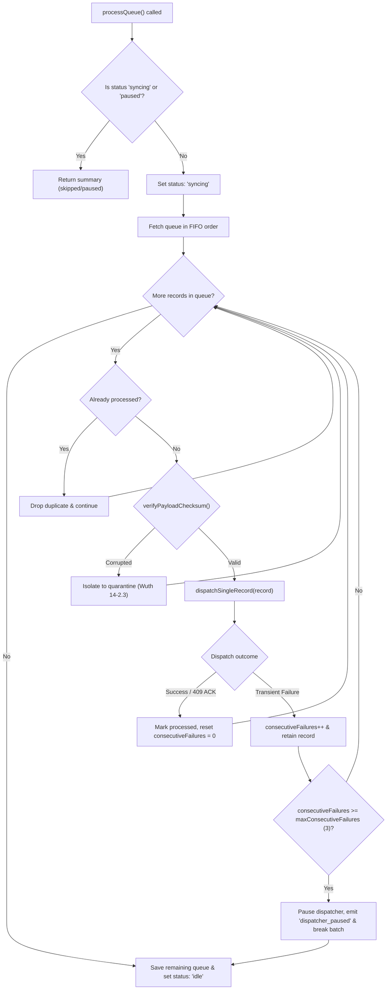

# Offline Checksum & Automated Background Dispatcher Architecture

This document specifies the technical design, algorithm, versioning approach, and integration patterns for the offline caching and background synchronization systems.

---

## 1. Checksum & Hash Generator (Story 14-2 Subtask 1 — Ball)

### 1.1 Goal & Acceptance Criteria
- **Deterministic hash/checksum**: Guarantees identical outputs across JavaScript environments (browsers, Node.js, Bun) and regardless of JSON key ordering, floating point formatting quirks, or timestamp string variants.
- **Stored alongside cached payload**: Automatically attached to every transaction record when enqueued for local offline storage (`checksum`, `checksum_version`, `cached_at`).
- **Documented algorithm + versioning approach**: Versioned format allowing seamless future schema evolution without breaking historical offline records.

### 1.2 Algorithm Specification

#### Hashing Function
- **Standard**: SHA-256 (FIPS 180-4) producing a 64-character lowercase hexadecimal digest.
- **Engine**: Native Web Crypto API (`crypto.subtle.digest`) with automatic fallback to Node/Bun `crypto` module.

#### Canonicalization Rules (Version `v1`)
To ensure strict determinism before hashing, the payload fields are extracted, normalized, and concatenated into a canonical string:
1. `transaction_id`: Trimmed UTF-8 string (e.g. UUID).
2. `kiosk_id`: Trimmed identifier (e.g. `KIOSK-001`).
3. `meter_volume`: Float normalized to 4 decimal places via `toFixed(4)` (e.g. `42.5` -> `42.5000`). This eliminates floating-point precision mismatches across runtimes.
4. `recorded_at`: Normalized to UTC ISO-8601 string (`new Date(recorded_at).toISOString()`).

**Canonical String Template (`v1`)**:
```text
v1|kiosk:<kiosk_id>|meter:<meter_volume_fixed4>|recorded:<recorded_at_iso>|txn:<transaction_id>
```

*Example*:
```text
v1|kiosk:KIOSK-001|meter:42.5000|recorded:2026-10-17T12:00:00.000Z|txn:TXN-98765-TEST
```

*Why pipe-delimited key prefixes?*
Prefixing each segment with its field name and separating with `|` prevents concatenation collision attacks (e.g., distinguishing `kiosk:A|meter:12` from `kiosk:A1|meter:2`).

### 1.3 Versioning Strategy

- **Active Version**: `CURRENT_CHECKSUM_VERSION = 'v1'`.
- **Payload Envelope**:
  ```typescript
  export interface TransactionPayload {
    transaction_id: string;
    kiosk_id: string;
    meter_volume: number;
    recorded_at: string;
    checksum?: string;           // 64-character SHA-256 hex digest
    checksum_version?: string;   // 'v1'
    cached_at?: string;          // ISO timestamp when saved locally
    quarantined_at?: string;     // ISO timestamp if isolated
    quarantine_reason?: string;  // Failure diagnostic if corrupted
  }
  ```
- **Migration & Evolution Path**:
  If future requirements add new attributes (e.g., pressure sensor reading, operator token), a new version `v2` can be registered:
  ```typescript
  // v2 canonical template example:
  // `v2|kiosk:${kiosk_id}|meter:${meter_volume}|op:${operator_id}|recorded:${recorded_at}|txn:${txn_id}`
  ```
  The verifier inspects `checksum_version` (or prefix `v1:`) and automatically executes the matching canonicalizer. Historical records cached offline before an app update will still validate correctly under their original schema.
- **Legacy Compatibility**:
  Supports `version: 'legacy'` which produces `SHA-256(transaction_id + kiosk_id + meter_volume)`.

### 1.4 API Reference (`src/lib/checksum.ts`)
- `generatePayloadChecksum(payload, options?)`: Computes deterministic checksum, version, and canonical string.
- `attachChecksumToPayload(payload, options?)`: Injects `checksum`, `checksum_version`, and `cached_at` directly into the record object.
- `verifyPayloadChecksum(payload, expectedChecksum?, version?)`: Validates payload integrity against bit rot or local tampering. Returns `{ isValid, error, computedChecksum, version }`.
- `generatePayloadHash(txn, kiosk, vol)`: Backward-compatible legacy hash generator.

---

## 2. Automated Sequential Background Dispatcher (Story 14-3 Subtask 2 — Ball)

### 2.1 Goal & Acceptance Criteria
- **Sequential dispatch with retry strategy**: FIFO processing lock ensuring out-of-order execution never occurs; retries transient failures with configurable exponential backoff.
- **Stops/pauses on repeated failures (Circuit Breaker)**: Automatically pauses execution when consecutive failures reach the threshold (default: 3), preventing battery/bandwidth drain and server overload.
- **Observability/logging included**: Structured timestamped logging, live telemetry (`getStats()`), and an event subscription bus (`subscribe()`).

### 2.2 Execution Flow & Mutex Locking



### 2.3 Circuit Breaker & Auto-Pause Behavior
- **Failure Threshold**: Configured via `maxConsecutiveFailures` (default: 3).
- **Auto-Pause Trigger**: If 3 records fail in a row due to network timeouts, 5xx errors, or connectivity drops, the dispatcher transitions to `'paused'`.
- **Protection**:
  - Halts the dispatch loop immediately.
  - Prevents burning ~34 seconds per item across dozens or hundreds of queued items.
  - Emits `dispatcher_paused` event to alert UI components (e.g. Sour's status banner).
- **Recovery**:
  - `dispatcher.resume(reason)`: Resets `consecutiveFailures = 0` and sets status back to `'idle'`.
  - Triggered automatically on reconnection (`window.addEventListener('online')`) or successful heartbeat probe.

### 2.4 Modular Storage Abstraction (`IQueueStorage`)
Allows **Pun** (14-1.1) to swap in an `IndexedDBQueueStorage` without altering any dispatcher logic:
```typescript
export interface IQueueStorage<T = TransactionPayload> {
  getQueue(): T[];
  saveQueue(items: T[]): void;
  getQuarantine(): T[];
  saveQuarantine(items: T[]): void;
  getProcessed(): string[];
  saveProcessed(ids: string[]): void;
}
```
Default implementation: `LocalStorageQueueStorage`.

### 2.5 Observability & Telemetry API

#### Live Telemetry (`dispatcher.getStats()`)
```typescript
interface DispatcherStats {
  status: 'idle' | 'syncing' | 'paused';
  queueLength: number;
  quarantineLength: number;
  processedCount: number;
  totalDispatched: number;
  totalFailed: number;
  totalQuarantined: number;
  consecutiveFailures: number;
  maxConsecutiveFailures: number;
  lastSyncAttemptAt: string | null;
  lastSuccessfulSyncAt: string | null;
}
```

#### Event Subscription (`dispatcher.subscribe(listener)`)
Events emitted:
- `status_change`: `{ status, previous, reason }`
- `item_enqueued`: `{ record, queueLength }`
- `item_dispatching`: `{ record, index, total }`
- `item_success`: `{ record, ack }`
- `item_retry`: `{ record, attempt, delayMs, error }`
- `item_failed`: `{ record, error, consecutiveFailures }`
- `item_quarantined`: `{ record, reason }`
- `dispatcher_paused`: `{ reason, consecutiveFailures }`
- `dispatcher_resumed`: `{ reason }`
- `batch_complete`: `{ processed, quarantined, failed, duplicates, paused, remainingQueueLength }`

---

## 3. Team Integration Summary

| Story / Task | Owner | Integration with Ball's Modules |
| :--- | :--- | :--- |
| **14-1.1**: Storage Schema | Pun | Implement `IQueueStorage` interface using IndexedDB and inject into `OfflineBackgroundDispatcher({ storage: new IndexedDBStorage() })`. |
| **14-1.2**: Local Queue | Earn | Uses `dispatcher.enqueue(record)` and `dispatcher.getQueue()`. FIFO ordering and checksum attachment are handled out-of-the-box. |
| **14-1.3**: Status Banner | Sour | Subscribes to `dispatcher.subscribe()` and calls `dispatcher.getStats()` to display pending counts, syncing state, and paused banners. |
| **14-2.1**: Checksum Generator | Ball (Me) | Fully implemented in `src/lib/checksum.ts` with automated deterministic SHA-256 hashing and versioning. |
| **14-2.2**: Conflict Detection | Project | Server-side comparison against `daily_logs` using unique `transactionId` and meter volume state. |
| **14-2.3**: Payload Isolation | Wuth | Dispatcher isolates corrupted records into quarantine via `quarantine(record, reason)` without stalling the queue. |
| **14-3.1**: Network Listener | Pun | On detecting transition from offline to online, call `dispatcher.resume('Network reconnected')` followed by `dispatcher.processQueue()`. |
| **14-3.2**: Sequential Dispatcher | Ball (Me) | Fully implemented in `src/lib/dispatcher.ts` with retry strategy, circuit-breaker pause, and observability. |
| **14-3.3**: Server ACK | Sour | Server ACK confirmation is captured by `submitTransactionLog` and emitted via `item_success` event. |
